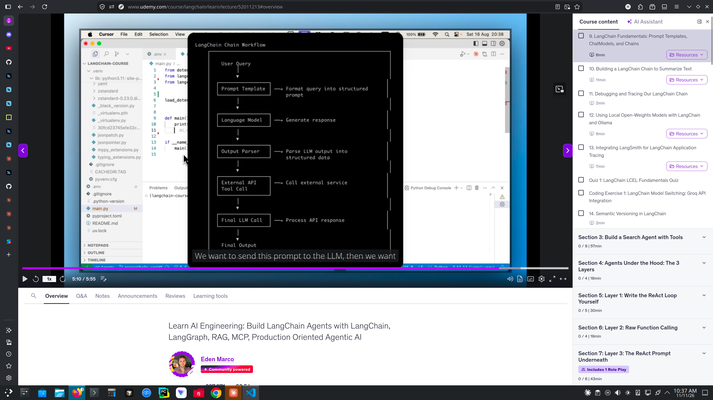
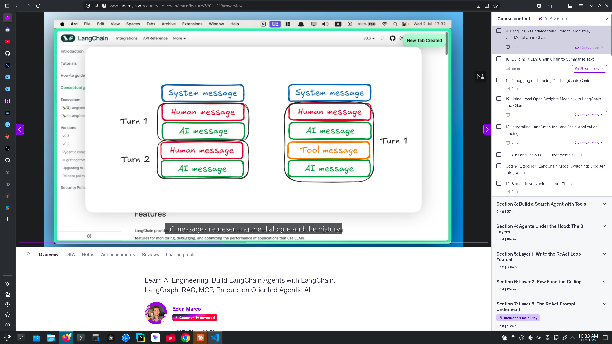

# LangChain

LangChain is an open source framework for building applications based on large language models (LLMs). It’s a framework, not a model, so it doesn’t generate text itself. Instead, it acts as the connecting layer around a model like GPT or Claude, so you can build a complete app instead of calling an API by hand.

A **chain** is a series of steps joined together, so the output of each step becomes the input of the next. This is where LangChain gets its name.

A typical chain has three steps:

Input → Prompt template → Chat model → Output parser → Final answer

The prompt template fills its placeholders with your input.
The chat model gets the finished prompt and replies with an AIMessage.
The output parser pulls out what you need, such as just the reply’s text.




# Main building blocks:

- Prompt templates: reusable prompts with placeholders you fill in.
- Chains: steps linked so one step’s output becomes the next step’s input (that’s where the name comes from).
- Memory: keeps track of earlier messages in a conversation.
- Agents: the LLM chooses which tools to use, such as a search engine or calculator, to finish a task.
- Retrieval (RAG): helps implement the retrieval-augmented generation (RAG) pattern, simplifying data retrieval from various sources, so the model can answer from your own documents.


# What is a prompt ?
A prompt is the input you give a large language model (LLM): the text that tells it what you want. The model reads the prompt and writes its response based on it.

# What is a prompt template ?

A prompt template is a reusable prompt with blanks (placeholders) that your code fills in at runtime. Think of it as a fill-in-the-blanks form for prompts.

Without a template, you’d have to write a separate prompt each time:

“Explain recursion to a beginner”
“Explain APIs to an expert”

With a template, you write it once:

"Explain {topic} to a {level} student"

Then you supply different values (topic="recursion", level="beginner") whenever you need them.


# What is a chat model ?
A chat model is an LLM built to take a conversation, meaning a list of messages, as input and return a new message as its reply. Most modern models work this way, including GPT, Claude and Gemini.


## How it differs from an older “text” LLM:

- Text LLM: takes one block of text and continues it. You send a string and get a string back.
- Chat model: takes a list of messages, each with a role, and replies as the next message in the conversation.

## The message roles:

- System: sets the model’s behavior and rules (“You are a friendly Python tutor”).
- Human / User: what the person says or asks.
- AI / Assistant: the model’s earlier replies, which give it the conversation’s history.

The model is shown the whole conversation each time, so it can answer in context. Follow-up questions like “explain that more simply” work because it can see what “that” refers to.




# Example Output


using GPT-5


```python
Hello World !!
content='Note: The following is based solely on the information you provided and may not reflect real-world facts.\n\nShort summary:\nAccording to the text, Elon Reeve Musk is an industrialist and technologist, CEO and largest shareholder of Tesla and SpaceX, and, since 2025, the world’s wealthiest person. He co-founded or led companies including Zip2, PayPal, SpaceX, Tesla, OpenAI, xAI, Neuralink, the Boring Company, and acquired Twitter (rebranded as X). The text also portrays him as a polarizing political figure, briefly serving in the Trump administration in 2025 and drawing controversy over his statements and platform moderation.\n\nTwo interesting facts:\n- Per the text, he became the first US-dollar trillionaire in June 2026 following a SpaceX IPO, though a subsequent stock drop took him below that mark.\n- The text says he served as an advisor to President Trump and acted as the de facto head of the Department of Government Efficiency (DOGE) in 2025.' 


additional_kwargs={'refusal': None} response_metadata={'token_usage': {'completion_tokens': 1244, 'prompt_tokens': 770, 'total_tokens': 2014, 'completion_tokens_details': {'accepted_prediction_tokens': 0, 'audio_tokens': 0, 'reasoning_tokens': 1024, 'rejected_prediction_tokens': 0, 'text_tokens':None}, 'prompt_tokens_details': {'audio_tokens': 0, 'cache_write_tokens': None, 'cached_tokens': 0, 'image_tokens': None, 'text_tokens': None}}, 'model_provider': 'openai', 'model_name': 'gpt-5-2025-08-07', 'system_fingerprint': None, 'id': 'chatcmpl-Eiv7g2Hk9V0UxlAuMX99GF7NGhbmt', 'service_tier': 'default', 'finish_reason': 'stop', 'logprobs': None} id='lc_run--01a1c911-5635-7588-bd7b-65c880e53bb5-0' tool_calls=[] invalid_tool_calls=[] usage_metadata={'input_tokens': 770, 'output_tokens': 1244, 'total_tokens': 2014, 'input_token_details': {'audio': 0, 'cache_read': 0}, 'output_token_details': {'audio': 0, 'reasoning': 1024}}
```


gpt-oss


``` python
Hello World !!
content='**Short Summary**  \nAva L. Chen (born March\u202f12,\u202f1984) is a South‑East Asian‑American entrepreneur, venture capitalist, and philanthropist.She co‑founded the AI‑driven logistics platform **FluxNet** in 2010, which revolutionized supply‑chain automation and earned her a spot on Forbes’ “30 Under 30” list. In 2015 she launched **HelioGrid**, a solar‑energy startup that now powers over 1\u202fmillion homes worldwide. By 2024, Chen had become the world’s youngest female billionaire, with a net worth of $1.2\u202ftrillion, and she serves on the boards of several Fortune\u202f500 companies.\n\n**Two Interesting Facts**  \n\n1. **Dual‑Citizenship Trailblazer** – Chen was born in Singapore to a Chinese mother and a Filipino father, grew up in Kuala\u202fLumpur, and later obtained U.S. citizenship after moving to Silicon Valley in 2006. She is the first person to hold citizenship in three countries (Singapore, Philippines, and the United States) while simultaneously leading three publicly traded companies.\n\n2. **Philanthropic “Zero‑Waste” Initiative** – In 2022, Chen founded the **Zero‑Waste Foundation**, which partners with municipalities to convert all food‑service waste into biogas and compost. The program has already reduced landfill waste in 15 major U.S. cities by 30\u202f% and generated enough renewable energy to power 200,000 homes annually.' 


additional_kwargs={} response_metadata={'model': 'gpt-oss:latest', 'created_at': '2026-11-11T06:37:01.070361839Z', 'done': True, 'done_reason': 'stop', 'total_duration': 6321373544, 'load_duration': 948817, 'prompt_eval_count': 831, 'prompt_eval_duration': 16416000, 'eval_count': 617, 'eval_duration': 6292727000, 'logprobs': None, 'model_name': 'gpt-oss:latest', 'model_provider': 'ollama'} id='lc_run--01a1c952-e25c-7685-9600-ba87cb9a54df-0' tool_calls=[] invalid_tool_calls=[] usage_metadata={'input_tokens': 831, 'output_tokens': 617, 'total_tokens': 1448}

```


gemma4


```python
Hello World !!
content='## Elon Reeve Musk\n\n### 📝 Short Summary\n\nElon Musk is a highly influential and polarizing industrialist, technologist, and entrepreneur, best known as the CEO and largest shareholder of Tesla and SpaceX. His ventures span multiple cutting-edge fields, including space exploration, electric vehicles, artificial intelligence (xAI), neurotechnology (Neuralink), and social media (X). Beyond his business empire, Musk has been a significant political figure, serving as an advisor to President Trump and holding a role in the Department of Government Efficiency (DOGE). His career is marked by massive financial success, rapid innovation, and intense public controversy regarding his political views and statements.\n\n***\n\n### 💡 Two Interesting Facts\n\n1. **Trillionaire Status and Pay Package:** Musk achieved the status of a US-dollar trillionaire in June 2026 upon the IPO of SpaceX. Furthermore, in November 2025, Tesla approved a massive pay package worth $1 trillion for him, contingent on achieving milestones such as a market capitalization of $8.5 trillion.\n2. **Political Transition:**After supporting Donald Trump in the 2024 election, Musk transitioned from a purely business figure to a political advisor, serving as the de facto head of the Department of Government Efficiency (DOGE) during the first half of the Trump administration in 2025.' 


additional_kwargs={} response_metadata={'model': 'gemma4:latest', 'created_at': '2026-11-11T06:50:20.631568324Z', 'done': True, 'done_reason': 'stop', 'total_duration': 10602249501, 'load_duration': 2694586838, 'prompt_eval_count': 833, 'prompt_eval_duration': 282933000, 'eval_count': 1058, 'eval_duration': 7616228000, 'logprobs': None, 'model_name': 'gemma4:latest', 'model_provider': 'ollama'} id='lc_run--01a1c95f-04ec-71fe-a669-ea769192a3b0-0' tool_calls=[] invalid_tool_calls=[] usage_metadata={'input_tokens': 833, 'output_tokens': 1058, 'total_tokens': 1891}
```


